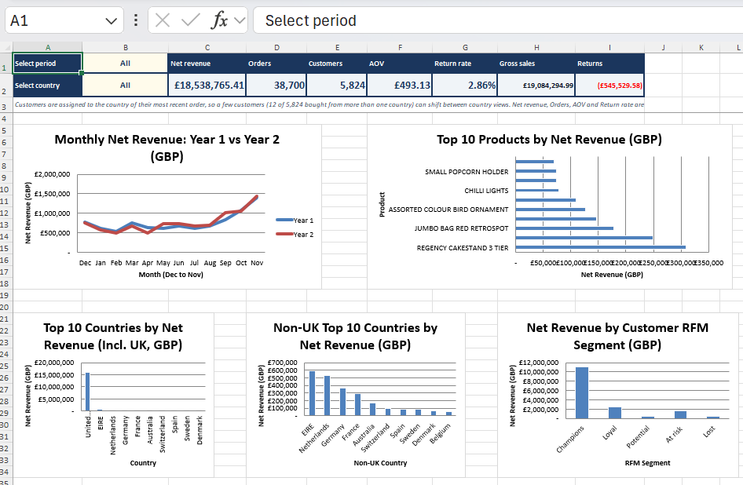
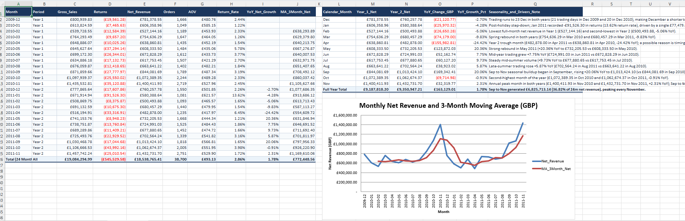
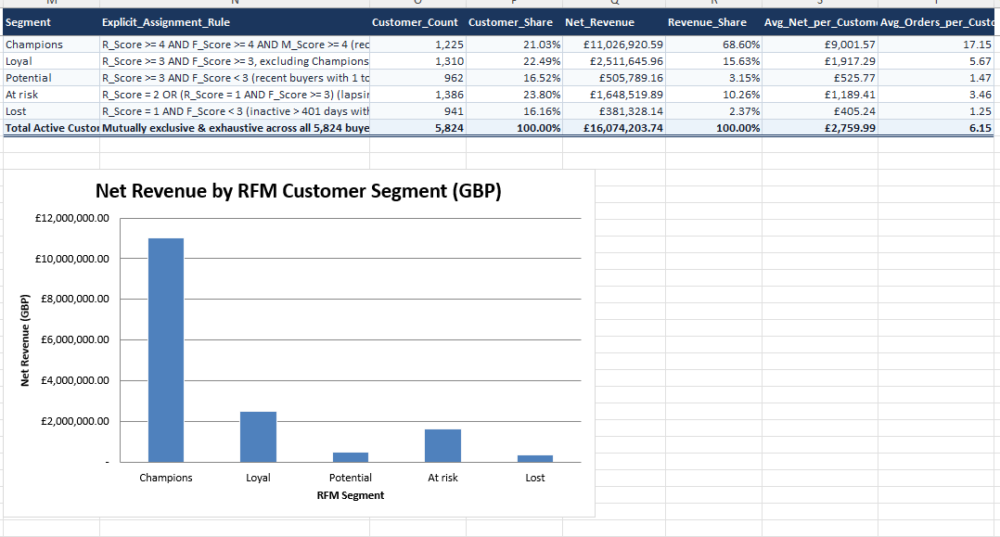
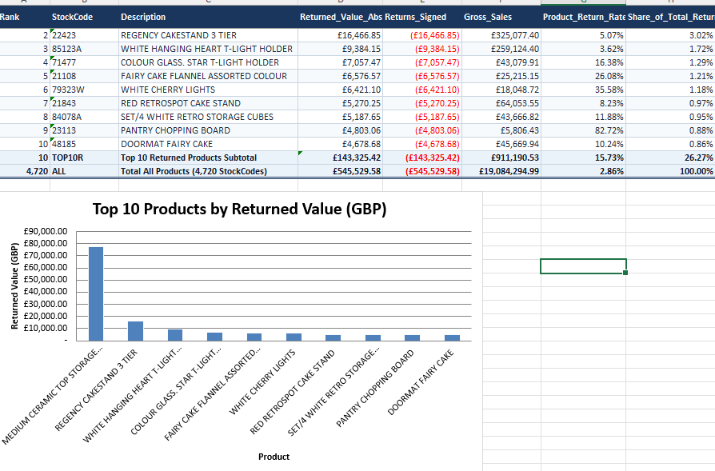
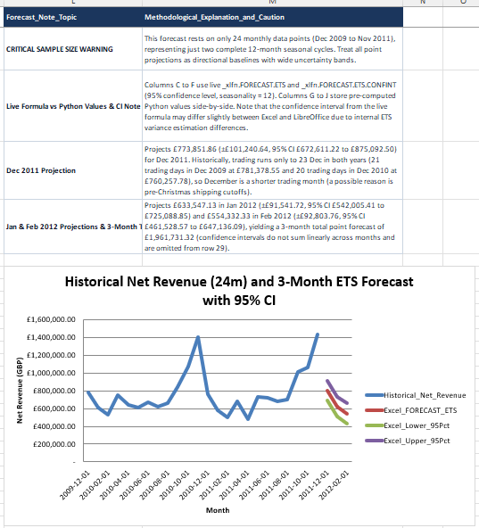

# Retail-Sales-Revenue-Analysis

An Excel analysis of two years of orders from a UK online gift retailer. It looks at where the revenue comes from, how much leaks out through returns, and which customers and countries matter most. The workbook uses live formulas, and its dashboard has period and country dropdowns.

## Data

[Online Retail II](https://archive.ics.uci.edu/dataset/502/online+retail+ii) from the UCI Machine Learning Repository, CC BY 4.0. It has 1,067,371 order lines from 1 Dec 2009 to 9 Dec 2011, in pounds.

The raw file needed cleaning before the numbers could be trusted:

- The analysis keeps 24 full months (1 Dec 2009 to 30 Nov 2011). The 25,526 lines from 1 to 9 Dec 2011 are dropped because that month is incomplete.
- The two raw sheets overlap for 1 to 9 Dec 2010 (22,523 identical lines). That stretch is counted once.
- 170 product codes appear in both upper and lower case (for example 85123A and 85123a). They are merged, which leaves 4,720 products.
- Invoices starting with C are cancellations and count as returns.
- Postage, bank fees, discounts and manual adjustments are not products. They sit outside product revenue and are shown separately (net 95,986.84 GBP).
- 5,975 lines with a price of zero or less are excluded.
- 21.77% of lines have no customer ID. They stay in the revenue totals but not in the customer analysis.

## What the workbook does

Revenue is quantity times price, and net revenue is sales plus returns. Year 1 is Dec 2009 to Nov 2010. Year 2 is Dec 2010 to Nov 2011.

| Sheet | What it shows |
|---|---|
| Dashboard | Net revenue, orders, customers, average order value and return rate. Pick a period and a country and every box changes. |
| Monthly | 24 months of sales, returns, year-on-year change and a 3-month average |
| Products_Analysis | Top 20 products by net revenue and by units |
| Countries | Top 10 countries, and the UK against the rest |
| Customers_RFM | Each customer scored 1 to 5 on recency, frequency and spend, then placed in one of five segments |
| Pareto | How few customers produce 80% of the revenue |
| Returns | Most returned products and return rate by month |
| Time_Patterns | Revenue by weekday and hour |
| Forecast | Dec 2011 to Feb 2012, with a 95% range |
| Findings, Definitions, Notes_and_Checks | Findings written from live cells, a definition for every metric, every cleaning count, and tie-out checks |

Code built the invoice, product, customer and month-by-country tables. Every analysis sheet reads those tables through formulas.

## What I found

Net revenue was 18.54M GBP over the 24 months.

Net revenue rose 1.78%, from 9.19M to 9.35M GBP, even though orders fell 3.98%. Baskets got bigger: the average order value went from 477.57 to 509.34 GBP, up 6.65%.

September to November brought in 6.83M GBP, 36.82% of the total, and November was the biggest month in both years. December falls back, but sales stop on 23 December in both years, so it has only 20 or 21 trading days. Pre-Christmas shipping cut-offs may be the reason, though the data can't say.

Under a quarter of customers carry the business. 1,376 of 5,824 (23.63%) generate 80% of customer net revenue, and the 1,225 Champions alone bring in 68.6% of it. The 1,386 At risk customers hold 1.65M GBP of past revenue.

The UK gives 85.3% of net revenue and 91.6% of orders, at 459.45 GBP an order. Orders from the other 42 country values average 859.33 GBP, 1.87 times as much, led by EIRE, the Netherlands and Germany.

The overall return rate is 2.86%, but one cancellation of 77,479.64 GBP on StockCode 23166 in January 2011 pushed that month to 13.62% and makes up 14.2% of all returns.

75.39% of net revenue arrives between 10:00 and 15:59. Thursday is the biggest day. Sunday brings 9.49% and Saturday almost nothing.

The forecast puts December 2011 near 773,852 GBP (95% range 672,611 to 875,092), January near 633,547 and February near 554,332. Two years of history is thin, so treat it as a rough baseline.

## Limitations

- The data is a UK retailer's from 2009 to 2011, in pounds. The method would carry over to a Bangladeshi shop but the numbers would not, because Eid, cash on delivery and local delivery costs change the picture.
- It covers one company, so none of it is an industry benchmark.
- Each customer sits in the country of their most recent order. 12 of 5,824 bought from more than one country, so country views can be off by a customer or two. Revenue, orders, average order value and return rate are unaffected.
- Treating any code that doesn't start with a digit as a non-product also catches 220 real lines (gift vouchers, DCGS items), worth about 2,808 GBP.
- 11,511 identical lines (0.29% of net revenue) are kept, since a shop can ring up the same item twice.
- My explanations for monthly patterns are guesses. The data shows only what happened.

## How this was made

Gemini built the workbook, and Claude reviewed it and helped write this README and the summary. I chose the question and the dataset.

## Files

- `Retail_Sales_Revenue_Project.xlsx`: the workbook
- `Summary.pdf`: a one-page summary
- `dashboard.png`, `monthly.png`, `customers.png`, `returns.png`, `forecast.png`: screenshots

Prepared by Muhammad Sadat Samin.
